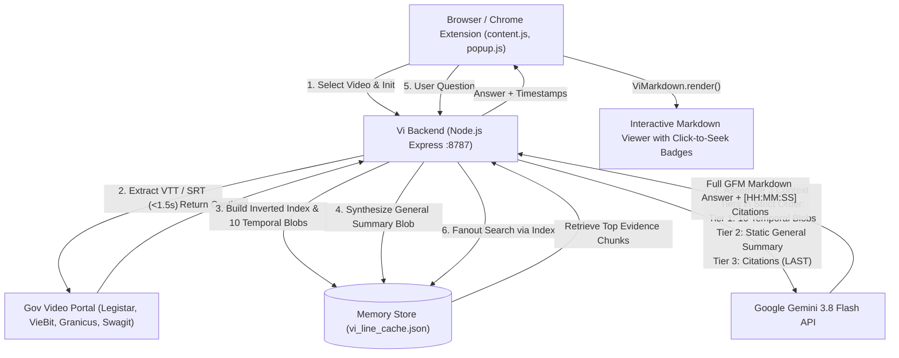

# Vi — NYC & NY State Government Video Assistant & QA

A Chrome Extension and Node.js RAG backend engineered for instant, zero-cost analysis and Q&A over New York City and New York State government hearing videos, council meetings, and legislative sessions.

Powered by **Gemini 3.8 Flash** with live Markdown rendering, instant video seeking, and automated caption extraction.

---

## 🌟 Key Features

1. **⚡ Fast Zero-Cost Caption Exploitation**
   - Extracts pre-existing WebVTT/SRT closed captions directly from official government video portals in **< 1.5 seconds**.
   - **Zero LLM / Speech-to-Text Cost**: Strictly restricted to exploitable official portals — never runs expensive Whisper or LLM audio transcription fallbacks for non-exploitable links.
   - **Supported Government Portals**:
     - **NYC Council Legistar / Granicus** (`council.nyc.gov`, `legistar.council.nyc.gov`, `*.granicus.com`)
     - **NYC & NY State Agency VieBit** (`*.viebit.com`, NYC Dept of Youth & Community Development, NYC Parks, etc.)
     - **Swagit Local Government Streaming** (`*.swagit.com`)
     - **New York State Senate & Assembly** (`nysenate.gov`, `nyassembly.gov`)
     - **Official NY Government YouTube Channels** (`*.youtube.com` via timed text caption tracks)

2. **🧠 3-Tier Multi-Context Architecture & Gemini 3.8 Flash**
   - **Context Type 1: Static Temporal Context (10 Timeline Memory Blobs)**:
     - After caption extraction, the transcript is partitioned into 10 approximately equal line segments (0% to 100% of duration).
     - Each blob provides dense, chronological milestone context (active speakers, topics, debates, transitions, and timeline markers).
   - **Context Type 2: Static General Summary Blob**:
     - A whole-video executive summary synthesized once after transcribing.
     - Grounds the model in overall committee mandate, presiding members, key witnesses, major policy conflicts, and conclusions.
   - **Context Type 3: Citations (Fetched via Fanout Queries — Primary Evidence)**:
     - Keyword query expansion generates 8–15 targeted fanout search terms evaluated against the Term-to-Line inverted index.
     - Fetches verbatim timestamped lines and neighboring context (+/- 8 lines).
     - **Guaranteed Placement**: Always placed as the **LAST type of memory** in the prompt passed to Gemini 3.8 Flash.
   - **Tuned Reasoning Budget**: Configured with `maxOutputTokens: 12288` (8192 thinking tokens headroom + 4096 answer budget) to prevent reasoning cutoff.

3. **🎨 Full Markdown Viewer & Interactive Timestamp Badges**
   - Safe custom Markdown-to-HTML parser (`markdown.js`) for both the Chrome Extension popup and the in-page "Ask Vi" overlay.
   - Parses timestamp citations (e.g. `[00:24:07–00:24:26]`) into interactive `⏱️ HH:MM:SS` pill buttons.
   - Clicking any timestamp badge automatically jumps the on-page HTML5 video player directly to that second.

4. **🚀 Production-Ready Architecture**
   - **Concurrency & Deduplication**: In-flight request coalescing (`inFlightJobs`) prevents duplicate processing of simultaneous requests for the same hearing.
   - **LRU In-Memory & Atomic Disk Persistence**: Safely saves indexed sessions to disk using atomic `.tmp` renames with an eviction cap of 1,000 hearings.
   - **Cloud Ready**: Standard Docker container (`Dockerfile`), Render blueprint (`render.yaml`), configurable `HOST` and `PORT`, and health check routes (`/` and `/api/health`).

---

## 🏗️ Architecture & 3-Tier Context Flow



---

## 🚀 Quick Start

### 1. Install & Configure Backend

```bash
# Clone and enter directory
cd /Users/rishabhmehta/Documents/MAP

# Install dependencies
npm install

# Configure environment variables (or copy from .env.example)
cp .env.example .env
# Edit .env with your GEMINI_API_KEY
```

### 2. Start the Backend Server

```bash
npm start
# Server listens on http://0.0.0.0:8787
# Health check available at: http://localhost:8787/api/health (or production https://vi-m5ke.onrender.com/api/health)
```

### 3. Load the Extension in Chrome

1. Open Google Chrome and navigate to `chrome://extensions/`.
2. Turn ON **Developer mode** (toggle in the top-right corner).
3. Click **Load unpacked**.
4. Select the project directory (`/Users/rishabhmehta/Documents/MAP`).
5. Pin **Vi** to your browser toolbar!

### 4. Build Production Extension Zip

To package the Chrome extension for distribution or Chrome Web Store upload:

```bash
npm run package:extension
# Generates dist/vi-extension.zip containing manifest v3 and all extension assets
```

---

## 🌐 API Reference

### Health Check
- **`GET /api/health`**
  ```json
  {
    "ok": true,
    "service": "vi-backend",
    "status": "online",
    "uptimeSec": 120,
    "cachedVideos": 6
  }
  ```

### Ingest Video Captions
- **`POST /api/vi/ingest`**
  - **Body**: `{ "url": "https://...mp4", "pageUrl": "https://legistar.council.nyc.gov/...", "title": "NYC Council Hearing" }`
  - **Response**: `{ "ok": true, "videoId": "...", "chunksCount": 184, "durationSec": 7200, "source": "official_captions" }`

### Chat with Video
- **`POST /api/vi/chat`**
  - **Body**: `{ "videoId": "...", "message": "What were the provider bed rates?", "pageUrl": "..." }`
  - **Response**: `{ "ok": true, "answer": "### Overview...\n- Providers testified...", "chunks": [...] }`

---

## 🚢 Production Deployment

### Docker Deployment
```bash
docker build -t vi-backend:latest .
docker run -d -p 8787:8787 -e GEMINI_API_KEY="your-gemini-key" vi-backend:latest
```

### Render Deployment
Connect your repository to Render. A [`render.yaml`](file:///Users/rishabhmehta/Documents/MAP/render.yaml) blueprint is pre-configured:
1. Log in to [Render Dashboard](https://dashboard.render.com).
2. Click **New +** > **Blueprint**.
3. Select your repository. Render will automatically configure the Web Service with health check path `/api/health`.
4. Enter your `GEMINI_API_KEY` under Environment Variables.
